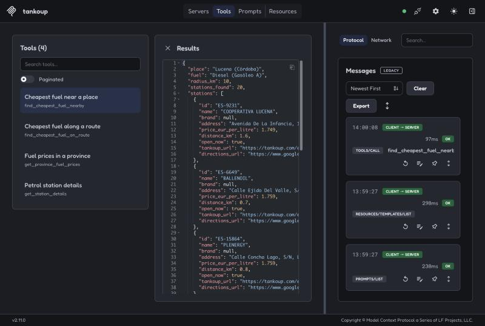

# TankoUp MCP server

Ask Claude, ChatGPT or any MCP client where to fill up for less in Spain.

This is the [Model Context Protocol](https://modelcontextprotocol.io) server for [TankoUp](https://tankoup.com), the app that finds the cheapest petrol station in Spain. It covers about 12,000 stations: mainland Spain, the Balearic and Canary Islands, Ceuta and Melilla. Prices come from the Spanish government's open data (MITECO) and refresh every 4 hours.

- **Endpoint:** `https://mcp.tankoup.com/mcp` (Streamable HTTP)
- **Authentication:** none. The data is public and the tools only read it.

> "Where is the cheapest diesel near Lucena?"
> "I'm driving from Madrid to Valencia tomorrow. Where should I fill up with 95?"
> "How much is petrol in Bizkaia compared with the rest of Spain?"

## Tools

| Tool | What it answers |
|---|---|
| `find_cheapest_fuel_nearby` | The best stations near a town, city or point, for one fuel |
| `find_cheapest_fuel_on_route` | The best stations along a driving route, up to 1,200 km |
| `get_province_fuel_prices` | Average and lowest prices in a province, its 30-day trend, how it compares with Spain, and its cheapest stations |
| `get_station_details` | Every fuel's price at one station, its opening hours, address and links |

Fuels: `diesel` (Gasóleo A), `diesel_premium`, `sp95` (Gasolina 95 E5), `sp95_e10`, `sp98` and `lpg` (GLP).

Stations are ranked by total cost, not by pump price alone: the price of a 40 L fill plus the fuel burned driving there and back (or leaving the route and rejoining it). A station 2 cents cheaper but 15 km away usually loses.

Places are Spanish towns and cities by name ("Lucena, Córdoba", "San Sebastián", "Palma"), resolved against every municipality with a fuel station. For a street, a landmark or the user's position, the client passes latitude and longitude.

Every answer is short and structured: a few stations, each with its price, distance, whether it is open now, a link to open it in TankoUp and a Google Maps directions link.

## Connect

**Claude** (claude.ai, Desktop and mobile): Settings → Connectors → Add custom connector, and paste `https://mcp.tankoup.com/mcp`.

**ChatGPT**: Settings → Apps → Advanced settings → turn on Developer mode, then Create app with the URL above and no authentication.

**Claude Code:**

```bash
claude mcp add --transport http tankoup https://mcp.tankoup.com/mcp
```

**Any other client** that speaks Streamable HTTP: point it at `https://mcp.tankoup.com/mcp`.



## How it works

```
Claude / ChatGPT ──MCP──▶ tankoup-mcp (Cloud Run) ──HTTPS──▶ TankoUp API ──▶ Postgres
                                                     (the API the app and website use,
                                                      fed from MITECO every 4 hours)
```

- Python with the official [MCP Python SDK](https://github.com/modelcontextprotocol/python-sdk) (v2), served over Streamable HTTP in stateless mode with JSON responses, so any instance can answer any request.
- The server owns no data. Every price comes from the same API that serves the TankoUp apps and website; it never touches the database or the government feed.
- Place names resolve offline against a gazetteer of every Spanish municipality with a fuel station (`src/tankoup_mcp/data/places.json`, built from the API by `scripts/build_places.py`). No geocoding service, no third party.
- Answers are cached in memory for 10 minutes.
- Limits: 120 requests a minute per client IP and 600 a minute per instance, at most one instance, and 100 route searches a day.
- Runs on Google Cloud Run in `europe-west1` (Belgium), scaling to zero when idle.

## Privacy

The server keeps no record of what you ask. It logs one line per tool call with the tool's name, the protocol version and how long it took; never the arguments, places or coordinates. Like any web service it sees the caller's IP address, which for Claude and ChatGPT is the platform's, not yours; Google Cloud's request logs keep it for 30 days. Nothing is shared with anyone. TankoUp's privacy policy: <https://tankoup.com/en/legal/privacy-policy>.

## Run it yourself

Requires Python 3.12+ and [uv](https://docs.astral.sh/uv/).

```bash
uv sync
TANKOUP_API_KEY=... uv run uvicorn tankoup_mcp.app:app --port 8000
```

Then open MCP Inspector against `http://localhost:8000/mcp`:

```bash
npx @modelcontextprotocol/inspector
```

| Variable | Default | |
|---|---|---|
| `TANKOUP_API_KEY` | — | Key for the TankoUp API |
| `TANKOUP_API_URL` | `https://api.tankoup.com` | |
| `CACHE_TTL_S` | `600` | How long answers are cached |
| `RATE_LIMIT_PER_IP` | `120` | Requests to `/mcp` per client IP per minute |
| `RATE_LIMIT_GLOBAL` | `600` | Requests to `/mcp` per instance per minute |
| `ROUTE_DAILY_LIMIT` | `100` | Route searches per instance per day |
| `ALLOWED_HOSTS` | empty | Host allowlist; empty turns DNS-rebinding protection off, which is right behind Cloud Run |

### Tests

```bash
uv run pytest
```

Every tool is tested against a mocked API with real response shapes, plus the HTTP layer: a legacy client's handshake and tool call, rate limits, CORS and health.

### Deploy

```bash
scripts/setup-gcp.sh   # once: the API key in Secret Manager and a service account
scripts/deploy.sh      # build in Cloud Build and deploy to Cloud Run
```

## License

[MIT](LICENSE). Fuel price data: Ministerio para la Transición Ecológica y el Reto Demográfico (MITECO), Spain, open data.
